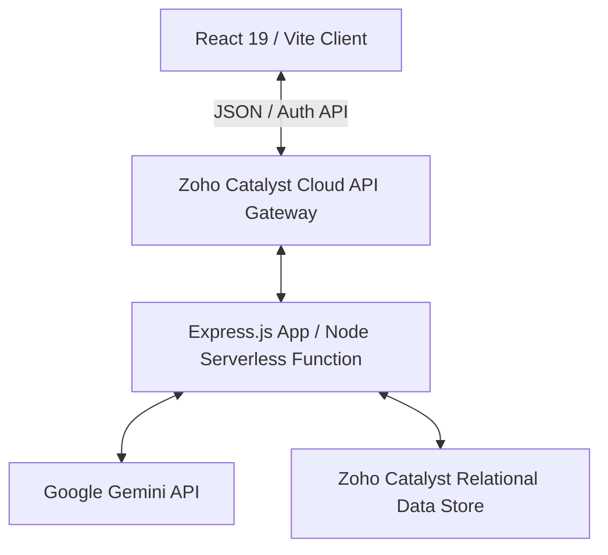

# 🦅 GARUDA AI

> **AI-Powered Financial Fraud Investigation Platform for Tracing Multi-Hop Money Flow During the Golden Hour.**

---

## 📖 Table of Contents
1. [Overview](#-overview)
2. [Key Features](#-key-features)
3. [Architecture & Tech Stack](#-architecture--tech-stack)
4. [Database Schema](#-database-schema)
5. [Project Directory Structure](#-project-directory-structure)
6. [Getting Started](#-getting-started)
7. [API & AI Engine](#-api--ai-engine)
8. [License](#-license)

---

## 🔍 Overview

**GARUDA AI** is a state-of-the-art, enterprise-grade financial intelligence and fraud investigation platform. Built specifically for financial analysts, fraud investigators, and Law Enforcement Agencies (LEAs), the application is optimized for **"The Golden Hour"**—the critical time window immediately following a financial fraud incident when stolen funds can still be traced and frozen before disappearing into offshore accounts or digital assets.

By leveraging advanced graph visualizations and Google Gemini LLMs, GARUDA AI automatically tracks multi-hop transaction trails, calculates entity risk scores, and generates actionable compliance notices (such as Section 91 CrPC legal notices) in seconds.

---

## ✨ Key Features

### 📊 Real-Time Incident Dashboard
* **Dynamic Counter Indicators:** Tracks Total Scammed Amount, Active Cases, High-Risk Accounts, and Recovered Funds.
* **Golden Hour Alert Center:** Lists urgent alerts detailing immediate steps for active fraud reports.
* **Aggregated Visualizations:** Displays fraud distribution category metrics and weekly trends using Recharts.

### 🌐 Multi-Hop Money Flow Visualization
* **Interactive SVG Graph:** Maps complex money movement across multiple bank accounts.
* **Offshore/Crypto Node Highlighting:** Flags high-risk connections (e.g., Panama shell corps, crypto exchanges, BVI accounts) with neon threat-level colors.
* **Deep Inspect Tooltip:** Click nodes or transaction links to view balances, bank jurisdictions, transaction categories, and timestamps instantly.

### 🤖 Generative AI Verdicts
* **Gemini LLM Integration:** Automated forensic analysis evaluating account behavior, hops, and risk triggers.
* **Detailed Reasoning:** Generates a structured narrative explaining why an account is flagged.
* **Floating AI Chatbot:** An omnipresent security assistant enabling analysts to ask context-aware questions.

### ⚖️ Automated Compliance & Enforcement
* **Section 91 CrPC Legal Notices:** One-click automated PDF/Document generation formatted for Indian law enforcement standards to serve to banks.
* **Emergency Freeze Actions:** Instantly mark accounts or transactions as "Frozen" to halt outbound money hops.

### ⚡ Enterprise Interface
* **Command Palette (`Ctrl + K` or `Cmd + K`):** Instantly search transactions, jump to specific pages, or trigger emergency actions.
* **Sleek Cyber-Dark Theme:** Tailored for security operations centers, complete with high-contrast neon indicators, glassmorphic cards, and smooth Framer Motion micro-interactions.

---

## 🛠️ Architecture & Tech Stack

:

### 🤖 API & AI Engine
Explains how the backend function (index.js) connects to the Google Gemini SDK to calculate multi-hop risk profiles and format compliance notices.

### 📄 License
States that the project is proprietary and built for financial intelligence and Law Enforcement investigations.

